# Tutorial: store, read, rename and delete a file

This walkthrough is the team's demo. In about 10 minutes you'll start the service, then take one file through its whole life in Dropbox: upload it, read it back, download it, rename it, and delete it. Along the way you'll see how the service refuses requests it shouldn't carry out.

Each step gives the command, the result we expect, and the actual result from a real run against Dropbox, with a screenshot.

| Step | What you'll see | Built by |
| --- | --- | --- |
| 1 | Setup and health check | Yashwanth |
| 2 | Upload, and a second upload refused with `409` | Annie |
| 3 | Metadata | Dayana |
| 4 | Download | Dayana |
| 5 | Rename / move, and a move onto an existing file refused with `409` | Laya |
| 6 | Delete, and a repeated delete returning `404` | Shini |
| 7 | Bad requests refused | Laya |
| 8 | Trace a failed request in the server log | Annie |
| 9 | Swagger page listing every route's errors | Shini |
| 10 | Run the tests (the same checks CI runs) | Yashwanth |

The commands are for macOS / Linux. On Windows, run them in Git Bash or WSL.

## 1. Start the service

Follow [README > Setup](README.md#setup) once: create the `doc` virtual environment, install `requirements.txt`, and put your Dropbox credentials in `.env`. Then:

```bash
source doc/bin/activate
python -m scripts.verify_dropbox      # prints your Dropbox account name
uvicorn app.main:app --reload
```

Leave that running and use a second terminal for the rest.

**Run:**
```bash
curl -i http://127.0.0.1:8000/health
```

**Expected:** `200 OK` with `{"status":"ok"}`.

**Actual:**
```
HTTP/1.1 200 OK
{"status":"ok"}
```

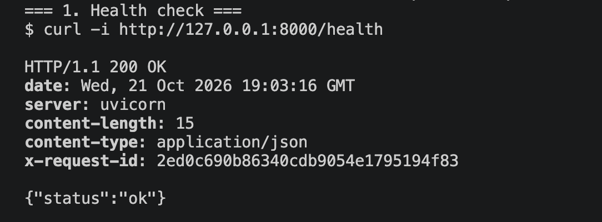

Make two small files to work with:

```bash
printf 'Quarterly report: revenue up 12%%.\n' > report.txt
printf 'Draft notes.\n' > notes.txt
```

## 2. Upload a file

**Run:**
```bash
curl -i -X POST http://127.0.0.1:8000/files -F "file=@report.txt" -F "path=/tutorial/report.txt"
```

**Expected:** `201 Created` with the file's `id`, `name`, `path` and `size` (34 bytes).

**Actual:**
```
HTTP/1.1 201 Created
{"id":"id:QqRAUO3-OU4AAAAAAAAARg","name":"report.txt","path":"/tutorial/report.txt","size":34,"modified_at":"2026-10-21T19:06:26"}
```

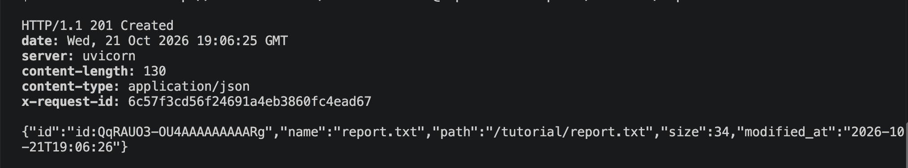

The file is now in Dropbox under `Apps/<your app>/tutorial/`. The response is our own `FileResource`, not Dropbox's raw metadata.

**Failure case: upload to the same path again.**

**Expected:** `409 conflict`. The service never overwrites a file, and the first file is left as it was.

**Actual:**
```
HTTP/1.1 409 Conflict
{"error":{"code":"conflict","message":"File already exists: /tutorial/report.txt"}}
```

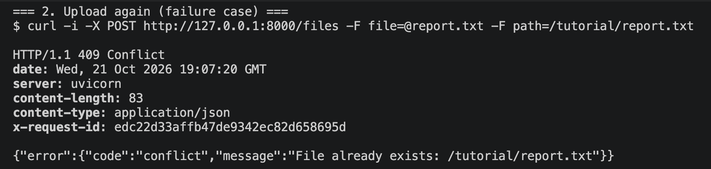

## 3. Read its metadata

**Run:**
```bash
curl -i "http://127.0.0.1:8000/files/metadata?path=/tutorial/report.txt"
```

**Expected:** `200 OK` with the same `id`, `name`, `path` and `size` as the upload.

**Actual:**
```
HTTP/1.1 200 OK
{"id":"id:QqRAUO3-OU4AAAAAAAAARg","name":"report.txt","path":"/tutorial/report.txt","size":34,"modified_at":"2026-10-21T19:06:26"}
```

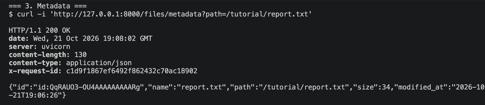

## 4. Download it

**Run:**
```bash
curl -s -D - -o downloaded.txt "http://127.0.0.1:8000/files/download?path=/tutorial/report.txt"
cmp report.txt downloaded.txt && echo "bytes match"
```

**Expected:** `200 OK`, headers that tell a browser to save the file as `report.txt`, and exactly the bytes that were uploaded.

**Actual:**
```
HTTP/1.1 200 OK
content-disposition: attachment; filename="report.txt";filename*=UTF-8''report.txt
content-type: application/octet-stream
bytes match
```

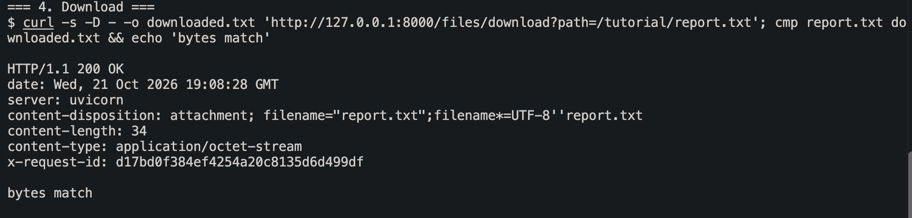

## 5. Rename it

First, the failure case. Upload `notes.txt`, then try to move it onto `report.txt`, which already exists:

**Run:**
```bash
curl -s -X POST http://127.0.0.1:8000/files -F "file=@notes.txt" -F "path=/tutorial/notes.txt"
curl -i -X PATCH "http://127.0.0.1:8000/files?path=/tutorial/notes.txt" \
  -H "Content-Type: application/json" -d '{"new_path": "/tutorial/report.txt"}'
```

**Expected:** `409 conflict`. Nothing moves and neither file changes.

**Actual:**
```
HTTP/1.1 409 Conflict
{"error":{"code":"conflict","message":"File already exists: /tutorial/report.txt"}}
```

Downloading both files afterwards still returns `Quarterly report: revenue up 12%.` and `Draft notes.`

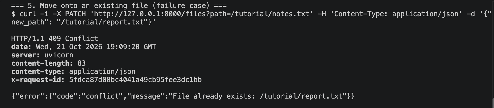

Now rename `report.txt` to a free name:

**Run:**
```bash
curl -i -X PATCH "http://127.0.0.1:8000/files?path=/tutorial/report.txt" \
  -H "Content-Type: application/json" -d '{"new_path": "/tutorial/final-report.txt"}'
```

**Expected:** `200 OK` with the new name and path, and the **same** `id` and `size`, because Dropbox moves the file rather than copying it.

**Actual:**
```
HTTP/1.1 200 OK
{"id":"id:QqRAUO3-OU4AAAAAAAAARg","name":"final-report.txt","path":"/tutorial/final-report.txt","size":34,"modified_at":"2026-10-21T19:09:51"}
```

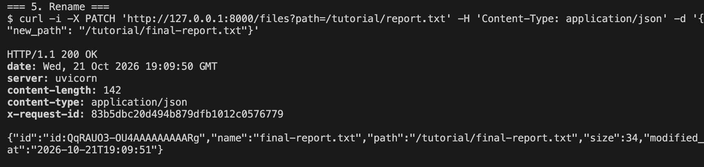

**Failure case: the old path is gone.**

**Run:**
```bash
curl -i "http://127.0.0.1:8000/files/metadata?path=/tutorial/report.txt"
```

**Expected:** `404 not_found`.

**Actual:**
```
HTTP/1.1 404 Not Found
{"error":{"code":"not_found","message":"File not found: /tutorial/report.txt"}}
```

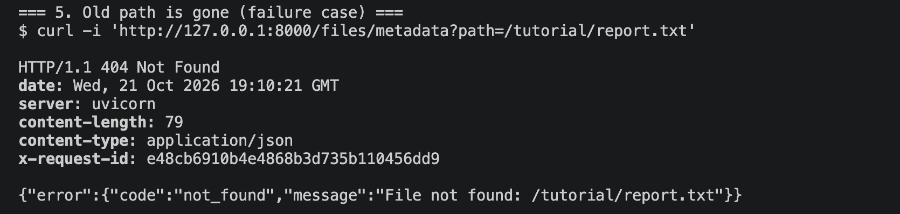

## 6. Delete it

**Run:**
```bash
curl -i -X DELETE "http://127.0.0.1:8000/files?path=/tutorial/final-report.txt"
```

**Expected:** `204 No Content`, with no body.

**Actual:**
```
HTTP/1.1 204 No Content
```

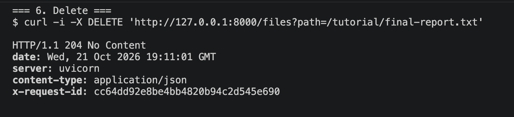

**Failure case: delete it again.**

**Expected:** `404 not_found`, because nothing is there any more.

**Actual:**
```
HTTP/1.1 404 Not Found
{"error":{"code":"not_found","message":"File not found: /tutorial/final-report.txt"}}
```

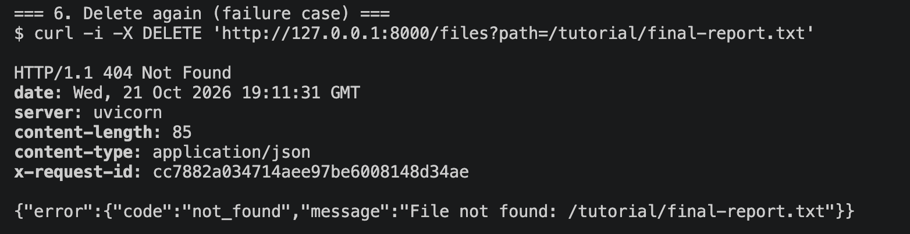

## 7. Requests the service refuses

**A path without a leading `/`**

**Run:**
```bash
curl -i "http://127.0.0.1:8000/files/metadata?path=report.txt"
```

**Expected:** `400 invalid_request`, rejected before Dropbox is called.

**Actual:**
```
HTTP/1.1 400 Bad Request
{"error":{"code":"invalid_request","message":"path must start with / and end with a file name: report.txt"}}
```

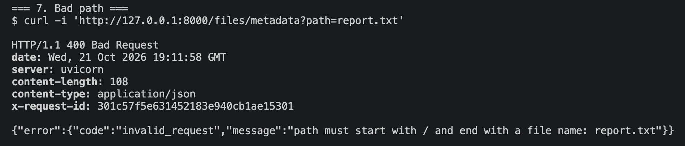

**Deleting a folder**

**Run:**
```bash
curl -i -X DELETE "http://127.0.0.1:8000/files?path=/tutorial"
```

**Expected:** `400 invalid_request`, because Dropbox would delete everything inside the folder.

**Actual:**
```
HTTP/1.1 400 Bad Request
{"error":{"code":"invalid_request","message":"Only files can be deleted: /tutorial"}}
```

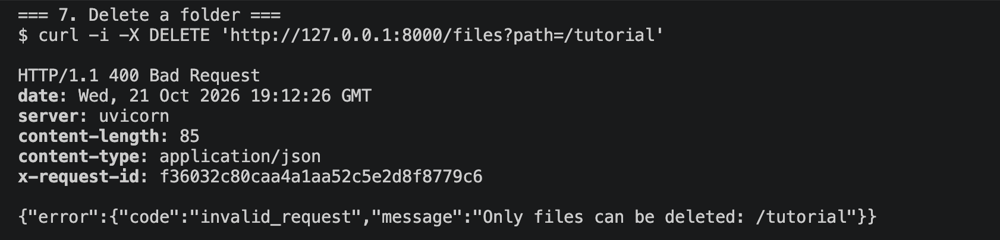

**A wrong URL or a wrong method**

**Run:**
```bash
curl -i http://127.0.0.1:8000/file          # typo: /file instead of /files
curl -i -X PUT http://127.0.0.1:8000/files   # PUT isn't supported
```

**Expected:** `404 not_found` and `405 method_not_allowed`, in our error shape rather than FastAPI's default.

**Actual:**
```
HTTP/1.1 404 Not Found
{"error":{"code":"not_found","message":"No such endpoint: GET /file"}}

HTTP/1.1 405 Method Not Allowed
{"error":{"code":"method_not_allowed","message":"Method not allowed: PUT /files"}}
```

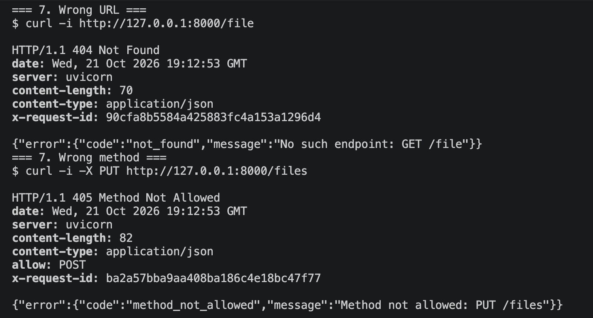

Every error, from any route, has the same shape: `{"error": {"code": "...", "message": "..."}}`. The full list of codes, with when each happens and whether to retry, is in [README > Errors](README.md#errors).

## 8. Trace a failed request

Every response carries an `X-Request-ID` header, and every failure is written to the server log with the same id.

**Run:**
```bash
curl -i "http://127.0.0.1:8000/files/metadata?path=/tutorial/missing.txt"
```

**Expected:** `404 not_found` with an `x-request-id` header, and a `request_failed` line in the server's terminal with the same id.

**Actual:**
```
HTTP/1.1 404 Not Found
x-request-id: 48d43b9c5abe48f29252ea05a765e192
{"error":{"code":"not_found","message":"File not found: /tutorial/missing.txt"}}
```

Server terminal:
```
dropbox_error operation=get_metadata error=FileNotFoundError dropbox_error=ApiError: GetMetadataError('path', LookupError('not_found', None)) request_id=7cf6a63ad9eb48099f300ddd6ad9137f
request_failed operation=read_metadata error=not_found status=404 provider=yes request_id=48d43b9c5abe48f29252ea05a765e192
```

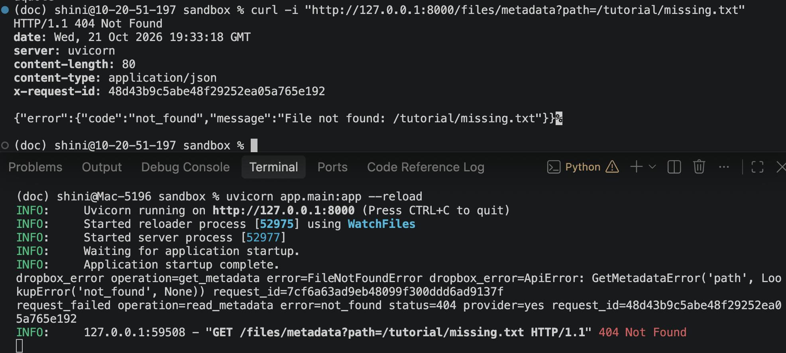

- `request_failed` has the same id as the response header, so a caller who reports a problem can quote the id and we can find their request.
- `provider=yes` means Dropbox was called and refused. A bad path (step 7) logs `provider=no`, because it was rejected before Dropbox.
- `dropbox_error` keeps Dropbox's own error and Dropbox's request id, for asking Dropbox support. The caller never sees it.
- Our two log lines (`request_failed`, `dropbox_error`) contain no file paths, tokens or file contents. The last line in the screenshot is different: it's uvicorn's own access log, which prints every request's URL, including `?path=...`. To turn that off, for example in production, start the server with `uvicorn app.main:app --no-access-log`.

## 9. Try it in the browser

Open [http://127.0.0.1:8000/docs](http://127.0.0.1:8000/docs).

**Expected:** every route is listed with its inputs and the errors it can return, and each has a **Try it out** button that sends real requests.

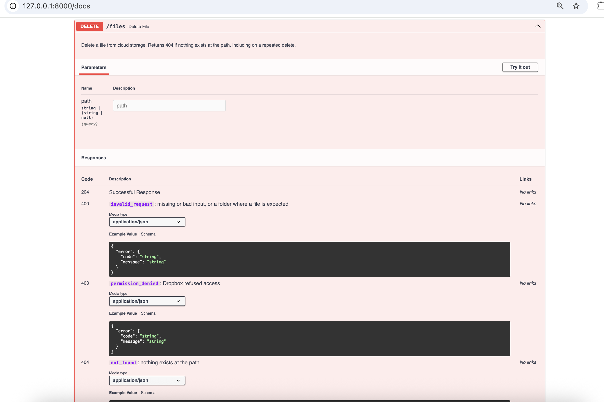

## 10. Run the tests

**Run:**
```bash
python -m pytest && python -m ruff check . && python -m mypy app
```

**Expected:** every test passes, and lint and type checks are clean. These are the same checks CI runs on every pull request.

**Actual:**
```
246 passed in 1.62s
All checks passed!
Success: no issues found in 25 source files
```

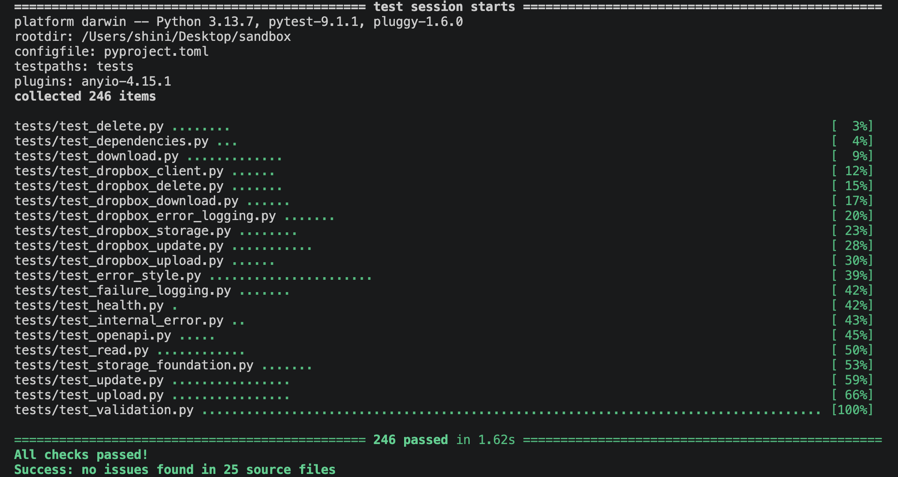

The screenshot was taken on Python 3.13. The project targets Python 3.10 (`.python-version`), and CI runs these same checks on 3.10 for every pull request. They also pass locally on 3.10.

These are the fast tests: no Dropbox, no network. The live Dropbox tests run separately with `python -m pytest tests/integration`. They create files under `/integration-tests/` and delete them when they finish. [TESTING.md](TESTING.md) explains what each layer of tests covers and why.

## 11. Clean up

```bash
curl -s -X DELETE "http://127.0.0.1:8000/files?path=/tutorial/notes.txt"
rm report.txt notes.txt downloaded.txt
```

- Stop the server with `Ctrl+C`.
- The empty `tutorial` folder stays in Dropbox under `Apps/<your app>/`. Delete it in the Dropbox website if you like. The service itself won't delete folders.
